# Kata Pengantar

Panduan ini disusun untuk membantu seluruh pengguna **Sistem Informasi Pengajuan dan Distribusi Barang Kebersihan (SIBERSIH) PLBN Wini** menjalankan tugasnya dengan benar dan percaya diri. Sistem ini menjadi tempat tercatatnya permintaan perlengkapan, keputusan Admin, penyerahan barang, bukti penerimaan, pesan distribusi, serta laporan yang dibutuhkan pimpinan.

Panduan disusun bukan dari rancangan atau asumsi, melainkan dari pemeriksaan langsung terhadap kode program, struktur basis data, dan tampilan aplikasi yang berjalan pada saat dokumen ini dibuat. Setiap menu, tombol, pesan, dan aturan validasi yang dijelaskan dapat ditelusuri kembali ke implementasi aplikasi. Bagian **Catatan Verifikasi dan Keterbatasan** pada akhir dokumen menjelaskan apa yang telah diperiksa dan apa yang belum dapat ditampilkan.

Pembaca akan dipandu secara bertahap: mengenal sistem dan hak akses, melakukan login, memahami tampilan, menggunakan menu Admin dan menu Pengguna, membaca alur kerja, menangani masalah umum, serta menerapkan kebiasaan penggunaan yang aman. Panduan ini dapat dibaca berurutan atau dibuka pada bagian yang sedang dibutuhkan.

Kami menyadari bahwa aplikasi dan kebutuhan organisasi dapat berkembang. Karena itu, panduan ini perlu diperbarui apabila terdapat perubahan menu, alur, atau kebijakan pengelolaan barang. Masukan dari pengguna sangat berharga untuk menjaga agar dokumen ini tetap akurat dan mudah dipahami.

| Informasi | Keterangan |
|---|---|
| Nama sistem | Sistem Informasi Pengajuan dan Distribusi Barang Kebersihan (SIBERSIH) PLBN Wini |
| Instansi | Badan Nasional Pengelola Perbatasan — Pos Lintas Batas Negara Wini |
| Jenis dokumen | Panduan penggunaan untuk Admin dan Pengguna |
| Edisi | Oktober 2026 |
| Cakupan | Login, dashboard, pengelolaan barang, pengajuan, distribusi, pesan, bukti penerimaan, laporan, dan pengelolaan akun |
| Dasar penyusunan | Pemeriksaan kode program, basis data, dan tampilan aplikasi yang berjalan |

# Pendahuluan

Panduan ini menjelaskan cara menggunakan **Sistem Informasi Pengajuan dan Distribusi Barang Kebersihan (SIBERSIH) PLBN Wini** dari awal hingga akhir. Seluruh langkah disusun berdasarkan tampilan dan fungsi aplikasi yang benar-benar berjalan pada saat panduan ini dibuat, bukan berdasarkan rancangan atau fitur yang direncanakan.

## Tujuan panduan

Panduan ini bertujuan membantu dua kelompok pengguna:

- **Admin**, yaitu pengelola data barang, pengajuan, distribusi, laporan, dan akun pengguna.
- **Pengguna**, yaitu pegawai yang mengajukan permintaan perlengkapan dan memantau status pengajuannya.

Setelah membaca panduan ini, pembaca diharapkan dapat:

- Membuka aplikasi dan melakukan login serta logout dengan benar.
- Mengenali menu yang tersedia sesuai hak aksesnya.
- Menyelesaikan tugas utama, mulai dari pengajuan barang sampai laporan tercetak.
- Menangani kesalahan umum tanpa bantuan teknis.

## Cara menggunakan panduan

- Bacalah **BAB I** terlebih dahulu untuk mengenal sistem dan hak akses.
- Admin sebaiknya membaca **BAB II**, **BAB III**, **BAB V**, **BAB VI**, dan **BAB VII**.
- Pengguna cukup membaca **BAB II**, **BAB IV**, **BAB VI**, dan **BAB VII**.
- Semua pembaca disarankan membaca **BAB VIII** tentang kebiasaan penggunaan yang aman.
- Setiap gambar diberi nomor dan keterangan, misalnya **Gambar 3.1. Dashboard Admin**, agar mudah dirujuk kembali.
- Istilah menu dan tombol ditulis persis seperti yang terlihat di layar, misalnya **Kelola Barang**, **Setujui**, atau **Catat Distribusi**.

> **Catatan tentang data pada gambar.** Screenshot diambil langsung dari aplikasi yang berjalan. Nama, username, dan NIK pada gambar disamarkan untuk melindungi data pribadi. Data contoh yang tampak (misalnya "Contoh Pengaju") bukan data resmi dan hanya dipakai agar layar mudah dijelaskan.

# BAB I — Mengenal Sistem dan Tampilan

## 1.1 Apa itu SIBERSIH PLBN Wini

SIBERSIH PLBN Wini adalah aplikasi berbasis web untuk mengelola permintaan dan penyaluran barang kebersihan di lingkungan Pos Lintas Batas Negara (PLBN) Wini. Aplikasi ini menggantikan pencatatan manual dengan satu alur kerja yang tercatat rapi, mulai dari pengajuan oleh pegawai sampai laporan bulanan bagi pimpinan.

Fungsi utama yang tersedia di aplikasi:

- **Pengajuan perlengkapan.** Pengguna memilih barang dan jumlah yang dibutuhkan, lalu mengirim pengajuan.
- **Persetujuan pengajuan.** Admin memeriksa pengajuan, lalu menyetujui atau menolaknya. Stok berkurang saat pengajuan disetujui.
- **Pencatatan distribusi.** Admin mencatat bahwa barang sudah diserahkan kepada pengaju.
- **Pesan distribusi.** Admin dapat mengirim pesan kepada pengaju melalui menu **Distribusi**. Pesan tampil pada menu **Pesan** milik Pengguna dan tidak mengubah status pengajuan.
- **Bukti penerimaan.** Pengguna mengunggah foto bukti bahwa barang benar-benar diterima.
- **Verifikasi bukti.** Admin memeriksa bukti tersebut. Pengajuan dinyatakan **Selesai** setelah bukti diverifikasi.
- **Laporan.** Admin mencetak laporan pengajuan yang sudah selesai, lengkap dengan kop instansi.

## 1.2 Tujuan penggunaan sistem

- Menghindari kehilangan catatan pengajuan dan distribusi barang.
- Mengetahui sisa stok barang secara langsung.
- Memastikan setiap barang yang keluar memiliki bukti penerimaan.
- Menyediakan laporan resmi yang siap dicetak dalam ukuran A4.
- Memisahkan tugas Admin dan Pengguna sehingga data lebih aman.

## 1.3 Siapa saja yang dapat menggunakan sistem

Aplikasi memiliki dua jenis akun yang aktif digunakan:

| Jenis akun | Siapa | Tugas utama |
|---|---|---|
| **Admin** | Pengelola perlengkapan atau operator sistem | Mengelola barang, memproses pengajuan, mencatat distribusi, mengirim pesan distribusi, memverifikasi bukti, mencetak laporan, dan mengelola akun pengguna |
| **Pengguna** | Pegawai PLBN Wini | Mengajukan perlengkapan, memantau status, menerima pesan dari Admin, mengunggah bukti penerimaan, dan melihat riwayat |

> **Penting.** Akun hanya dapat dibuat oleh Admin melalui menu **Kelola Anggota**. Tidak ada pendaftaran mandiri di halaman login. Jika Anda belum memiliki akun, hubungi Admin.

> **Catatan tentang jenis akun lain.** Struktur basis data masih menyimpan jenis akun `vendor`, tetapi aplikasi belum memiliki halaman atau alur kerja untuk vendor. Login dengan akun tersebut ditolak dengan pesan *"Akun ini tidak memiliki akses ke sistem."* Karena itu, panduan ini tidak membahas peran vendor.

## 1.4 Perbedaan hak akses Admin dan Pengguna

| Bagian | Admin | Pengguna |
|---|---|---|
| Dashboard | Dashboard Admin | Dashboard User |
| Melihat daftar barang | Ya, melalui **Kelola Barang** | Ya, melalui **Daftar Barang** |
| Menambah, mengubah, menghapus barang | Ya | Tidak |
| Melihat semua pengajuan | Ya | Hanya pengajuannya sendiri |
| Menyetujui atau menolak pengajuan | Ya | Tidak |
| Mencatat distribusi | Ya | Tidak |
| Mengirim pesan distribusi | Ya, melalui menu **Distribusi** | Tidak |
| Membaca pesan dari Admin | Tidak | Ya, melalui menu **Pesan** |
| Mengunggah bukti penerimaan | Tidak | Ya |
| Memverifikasi bukti penerimaan | Ya | Tidak |
| Mencetak laporan | Ya | Tidak |
| Mengelola akun pengguna | Ya | Tidak |

Pengguna yang mencoba membuka halaman Admin akan diarahkan kembali ke halaman login atau dashboard sesuai pemeriksaan hak akses aplikasi.

## 1.5 Perangkat dan browser yang dibutuhkan

- **Komputer atau laptop** dengan layar minimal 1.280 piksel. Tampilan aplikasi dirancang untuk layar lebar; pada layar kecil, sidebar dapat dibuka melalui tombol menu.
- **Browser modern**: Google Chrome, Microsoft Edge, atau Mozilla Firefox versi terbaru. Panduan ini menggunakan tampilan Chrome.
- **Koneksi jaringan** ke server tempat aplikasi dipasang. Koneksi internet juga disarankan agar ikon dan huruf tampil sempurna.
- **Printer** (khusus Admin) jika ingin mencetak laporan. Jika tidak ada printer, laporan dapat disimpan sebagai PDF.

## 1.6 Cara membuka aplikasi

Alamat aplikasi ditentukan oleh pengelola server. Bergantung pada tempat pemasangan, bentuk alamatnya dapat berbeda:

- **Komputer lokal (XAMPP):** `http://localhost/sistem_informasi_plbn_wini/`
- **Jaringan kantor:** `http://192.168.x.x/sistem_informasi_plbn_wini/` atau nama domain tertentu.

1. Buka browser, lalu ketik alamat aplikasi pada kolom alamat dan tekan **Enter**.
2. Halaman utama (landing page) akan muncul seperti pada Gambar 1.1.
3. Klik tombol **Login** di kanan atas atau tombol **Masuk ke Sistem** di tengah halaman untuk menuju halaman login.

> Jika halaman tidak muncul, periksa kembali alamat yang diberikan Admin, pastikan komputer terhubung ke jaringan kantor, dan pastikan server aplikasi menyala. Penanganan lengkap ada di BAB VII.

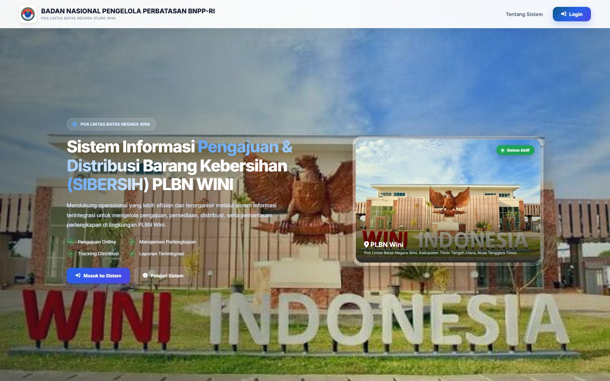

Halaman utama menampilkan nama sistem, ringkasan singkat layanan, dan tombol **Login**. Halaman ini dapat dibuka siapa saja tanpa perlu masuk, tetapi seluruh menu pengelolaan hanya dapat diakses setelah login.

## 1.7 Mengenal komponen tampilan sistem

Setelah login, seluruh halaman menggunakan pola tampilan yang sama. Mengenali komponen berikut akan memudahkan Anda mengikuti panduan pada bab-bab berikutnya.

| Komponen | Letak | Fungsi |
|---|---|---|
| **Sidebar** | Sisi kiri | Berisi menu sesuai hak akses. Menu yang sedang dibuka ditandai dengan latar lebih terang |
| **Header** | Atas halaman | Menampilkan nama halaman dan tombol **Logout**. Pada layar kecil muncul tombol menu bergaris tiga |
| **Kartu statistik** | Bagian atas dashboard | Menampilkan jumlah pengajuan pada setiap status |
| **Tabel data** | Tengah halaman | Menampilkan daftar barang, pengajuan, anggota, atau laporan |
| **Tombol aksi** | Di dalam tabel atau header | Menjalankan tindakan seperti **Detail**, **Edit**, **Hapus**, **Setujui**, atau **Catat Distribusi** |
| **Formulir** | Di dalam halaman atau jendela modal | Tempat mengisi data. Kolom bertanda bintang (*) wajib diisi |
| **Pencarian dan filter** | Atas tabel | Mempersempit data yang ditampilkan tanpa mengubah isi database |
| **Pesan status (flash)** | Di bawah header | Memberi tahu hasil tindakan, misalnya berhasil disimpan atau gagal karena data belum lengkap |
| **Notifikasi pesan** | Dashboard Pengguna dan menu **Pesan** | Menunjukkan jumlah pesan dari Admin yang belum dibaca |
| **Jendela konfirmasi** | Muncul setelah tombol tertentu | Meminta persetujuan sebelum tindakan penting dijalankan |

> **Membaca pesan status.** Pesan hijau berarti tindakan berhasil, merah berarti gagal, kuning berarti perlu perhatian, dan biru berarti informasi. Baca pesan ini sebelum melanjutkan langkah berikutnya.

# BAB II — Persiapan dan Akses: Login dan Logout

Bab ini menjelaskan hal yang perlu disiapkan sebelum memakai aplikasi, cara masuk dengan aman, cara mengatasi kegagalan login, dan cara keluar dari sistem.

**Yang perlu disiapkan sebelum login.**

- **Alamat aplikasi** dari Admin. Alamat dapat berbentuk alamat komputer lokal atau alamat jaringan kantor (lihat subbab 1.6).
- **Username dan password** yang diberikan Admin. Password awal sebaiknya segera diganti bila kebijakan kantor mengizinkan.
- **NIK yang terdaftar** pada akun, karena NIK dipakai untuk memulihkan username atau password.
- **Browser modern** dan koneksi ke server aplikasi.
- **Hak akses yang sesuai.** Admin memakai akun Admin; pegawai memakai akun Pengguna. Satu orang sebaiknya tidak memakai dua peran sekaligus.

## 2.1 Membuka halaman login

1. Buka alamat aplikasi di browser.
2. Klik **Login** pada pojok kanan atas halaman utama, atau klik **Masuk ke Sistem**.
3. Halaman **Login - PLBN Wini** akan terbuka (Gambar 2.1).

## 2.2 Mengenali bagian-bagian halaman login

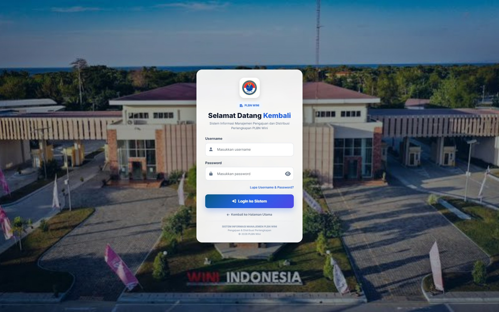

| Bagian | Keterangan |
|---|---|
| Logo dan tulisan **PLBN WINI** | Identitas aplikasi |
| **Username** | Kolom untuk mengisi nama akun yang diberikan Admin |
| **Password** | Kolom untuk mengisi kata sandi. Karakter ditampilkan sebagai titik-titik |
| Ikon mata di kolom password | Menampilkan atau menyembunyikan password yang sedang diketik |
| **Lupa Username & Password?** | Membuka halaman pemulihan akun berbasis NIK |
| **Login ke Sistem** | Tombol untuk memproses login |
| **Kembali ke Halaman Utama** | Kembali ke landing page tanpa login |

## 2.3 Langkah melakukan login

1. **Isi kolom Username.** Klik kolom **Username**, lalu ketik nama akun Anda. Perhatikan huruf besar dan kecil, karena username membedakan keduanya.
2. **Isi kolom Password.** Klik kolom **Password**, lalu ketik kata sandi. Gunakan ikon mata bila ingin memastikan password sudah benar.
3. **Klik tombol Login ke Sistem.**
4. **Perhatikan halaman yang muncul.**
   - Akun Admin diarahkan ke **Dashboard Admin**.
   - Akun Pengguna diarahkan ke **Dashboard User**.

> **Jangan membagikan password.** Admin tidak pernah meminta password melalui telepon atau pesan. Jika password diketahui orang lain, segera minta Admin menggantinya.

## 2.4 Mengatasi kesalahan login

Aplikasi menampilkan pesan berwarna merah di atas formulir jika login gagal (Gambar 2.2). Arti pesan yang mungkin muncul:

| Pesan pada layar | Arti | Yang perlu dilakukan |
|---|---|---|
| **Username dan password wajib diisi.** | Salah satu kolom masih kosong | Isi kedua kolom, lalu klik **Login ke Sistem** kembali |
| **Username atau password salah.** | Nama akun tidak ditemukan atau password tidak cocok | Periksa ejaan username dan huruf besar/kecil password. Gunakan ikon mata untuk memeriksa password |
| **Sesi login tidak valid. Muat ulang halaman lalu coba kembali.** | Halaman login sudah terlalu lama dibuka | Muat ulang halaman (F5), lalu login kembali |
| **Akun ini tidak memiliki akses ke sistem. Hubungi administrator.** | Jenis akun tidak dikenali aplikasi | Hubungi Admin untuk memperbaiki jenis akun |
| **Terjadi kesalahan pada sistem. Silakan coba kembali.** | Aplikasi tidak dapat menghubungi database | Tunggu beberapa saat dan coba lagi. Jika tetap gagal, hubungi pengelola sistem |

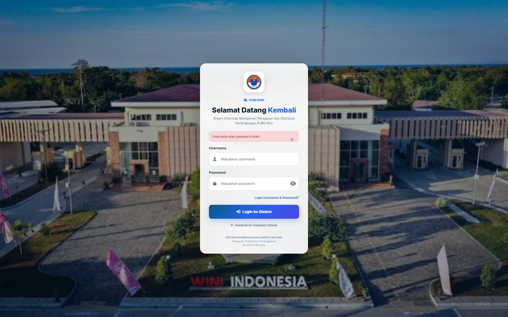

Jika password benar-benar lupa, gunakan tautan **Lupa Username & Password?**.

## 2.5 Memulihkan username atau password

Halaman pemulihan akun dapat digunakan tanpa login.

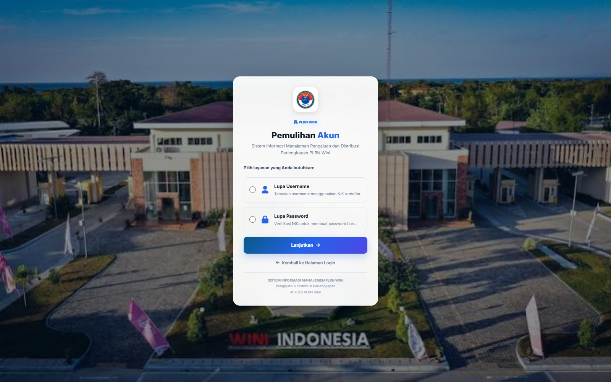

1. **Pilih layanan.** Pilih **Lupa Username** untuk mengetahui nama akun, atau **Lupa Password** untuk membuat password baru.
2. **Klik Lanjutkan.**
3. **Masukkan NIK.** Ketik 16 digit Nomor Induk Kependudukan yang terdaftar pada akun Anda.
4. **Centang pernyataan.** Bacalah pernyataan bahwa Anda melakukan pemulihan untuk akun sendiri, lalu centang kotaknya.
5. **Klik Verifikasi.**
6. **Tindak lanjuti hasilnya.**
   - Pada **Lupa Username**, aplikasi menampilkan username Anda. Catat dan simpan dengan aman.
   - Pada **Lupa Password**, isi **Password Baru** dan **Konfirmasi Password Baru**, lalu klik **Simpan Password Baru**.
7. **Login kembali** memakai username dan password yang baru.

> **Peringatan.** Layanan ini hanya memverifikasi NIK, tanpa kode OTP atau email. Karena itu, jangan memberitahukan NIK Anda kepada orang lain. Segera hubungi Admin bila Anda mencurigai adanya perubahan password yang bukan dilakukan sendiri.

## 2.6 Melakukan logout

Selalu logout setelah selesai, terutama pada komputer yang dipakai bersama.

1. Perhatikan sudut kanan atas atau bagian bawah sidebar.
2. Klik tombol merah **Logout**.
3. Aplikasi mengakhiri sesi dan menampilkan kembali halaman login.

Setelah logout, tombol **Back** pada browser tidak dapat membuka halaman dashboard. Jika masih terbuka, muat ulang halaman tersebut.

# BAB III — Panduan Admin

Bab ini menjelaskan seluruh menu yang hanya dapat diakses oleh akun Admin. Setiap subbab memuat tujuan fitur, cara membuka menu, arti elemen di layar, dan langkah penggunaan yang berurutan.

## 3.1 Mengenal tampilan Admin

Setelah login sebagai Admin, aplikasi menampilkan **Dashboard Admin**. Di sisi kiri terdapat sidebar berisi menu utama, dan di bagian atas terdapat tombol **Logout**.

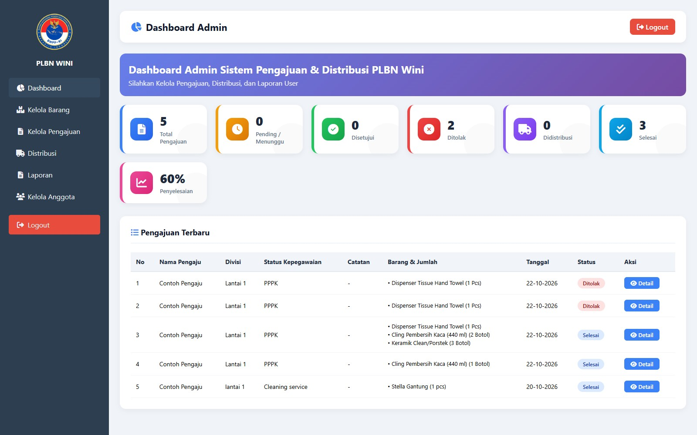

| Menu pada sidebar | Fungsi |
|---|---|
| **Dashboard** | Ringkasan jumlah pengajuan, status, dan daftar pengajuan terbaru |
| **Kelola Barang** | Menambah, mengubah, dan menghapus data barang serta stok |
| **Kelola Pengajuan** | Melihat semua pengajuan, menyetujui, menolak, dan mengubah pengajuan yang masih menunggu |
| **Distribusi** | Mencatat penyerahan barang dan memverifikasi bukti penerimaan |
| **Laporan** | Menampilkan dan mencetak laporan pengajuan yang sudah selesai |
| **Kelola Anggota** | Menambah, mengubah, dan menghapus akun Pengguna |
| **Logout** | Keluar dari aplikasi |

Pada layar yang lebih kecil, sidebar dapat dibuka dan ditutup melalui tombol bergaris tiga di sudut kiri atas.

## 3.2 Dashboard Admin

**Tujuan.** Memberi gambaran cepat tentang kondisi pengajuan dan memantau pengajuan terbaru tanpa membuka menu lain.

**Cara membuka.** Klik **Dashboard** pada sidebar.

**Elemen pada halaman.**

- **Kartu statistik** di bagian atas:
   - **Total Pengajuan**: seluruh pengajuan yang pernah masuk.
   - **Pending / Menunggu**: pengajuan yang belum diputuskan Admin.
   - **Disetujui**: pengajuan yang sudah disetujui dan stoknya sudah dikurangi.
   - **Ditolak**: pengajuan yang tidak disetujui.
   - **Didistribusi**: pengajuan yang barangnya sudah diserahkan dan menunggu bukti penerimaan.
   - **Selesai**: pengajuan yang bukti penerimaannya sudah diverifikasi.
- **Penyelesaian**: persentase pengajuan berstatus **Selesai** dibandingkan total pengajuan.
- **Pengajuan Terbaru**: tabel berisi nomor, nama pengaju, divisi, status kepegawaian, catatan, daftar barang beserta jumlah, tanggal, status, dan tombol **Detail**.

**Langkah penggunaan.**

1. Buka menu **Dashboard**.
2. Perhatikan angka pada kartu **Pending / Menunggu**. Angka yang bertambah berarti ada pengajuan baru yang perlu diproses.
3. Gulir ke tabel **Pengajuan Terbaru**.
4. Klik **Detail** pada baris yang ingin diperiksa. Aplikasi membuka halaman **Detail Pengajuan** pada menu Kelola Pengajuan.

**Hasil yang diharapkan.** Anda mengetahui jumlah pengajuan pada setiap status dan dapat langsung membuka pengajuan yang perlu ditindaklanjuti.

> Angka pada dashboard dihitung dari data yang tersimpan. Jika angka terlihat tidak sesuai, muat ulang halaman sebelum menyimpulkan ada kesalahan.

## 3.3 Kelola Barang

**Tujuan.** Menjaga daftar barang dan stok tetap benar, sehingga pengajuan dapat diproses dengan jumlah yang tersedia.

**Cara membuka.** Klik **Kelola Barang** pada sidebar.

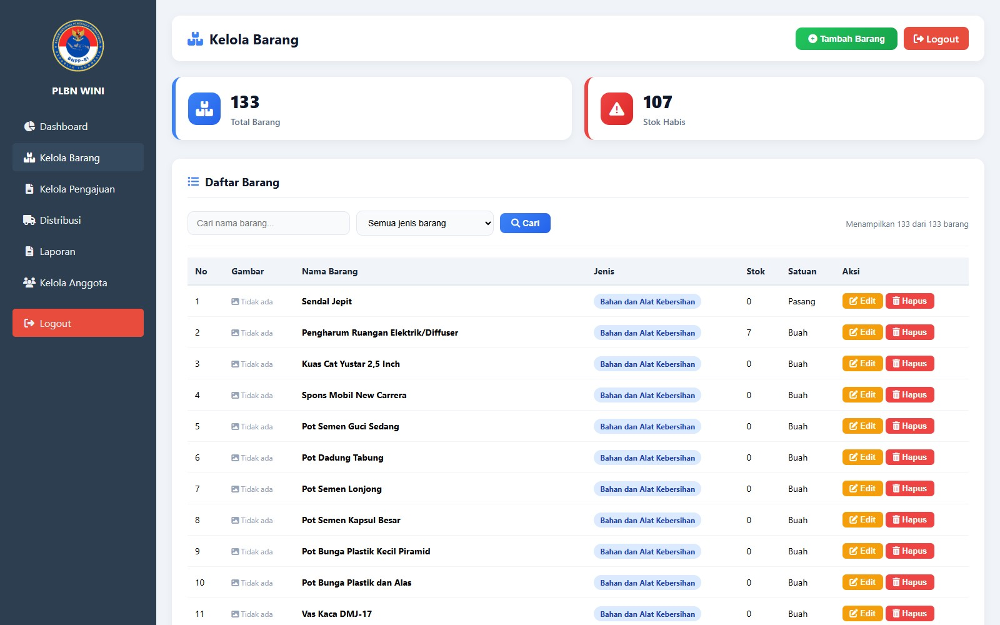

**Elemen pada halaman.**

- **Total Barang**: jumlah jenis barang yang terdaftar.
- **Stok Habis**: jumlah barang dengan stok 0.
- Tombol **Tambah Barang**: membuka formulir penambahan barang.
- Tabel **Daftar Barang** dengan kolom **No**, **Gambar**, **Nama Barang**, **Stok**, **Satuan**, dan **Aksi**.
- Tombol **Edit** dan **Hapus** pada setiap baris.

### 3.3.1 Menambah barang

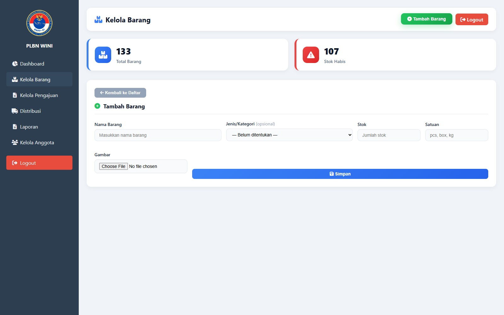

1. Klik **Tambah Barang** di kanan atas.
2. Isi **Nama Barang**. Maksimal 150 karakter, misalnya "Sabun Cuci Tangan".
3. Isi **Stok** berupa angka bulat, minimal 0.
4. Isi **Satuan**, misalnya `pcs`, `box`, atau `kg`.
5. Klik **Gambar** untuk memilih foto barang (opsional). Format yang diterima JPG, PNG, atau GIF dengan ukuran maksimal 2 MB.
6. Klik **Simpan**.
7. Aplikasi menampilkan pesan berhasil dan barang baru muncul di tabel.

Jika ingin membatalkan, klik **Kembali ke Daftar**. Data yang belum disimpan akan hilang.

### 3.3.2 Mengubah barang

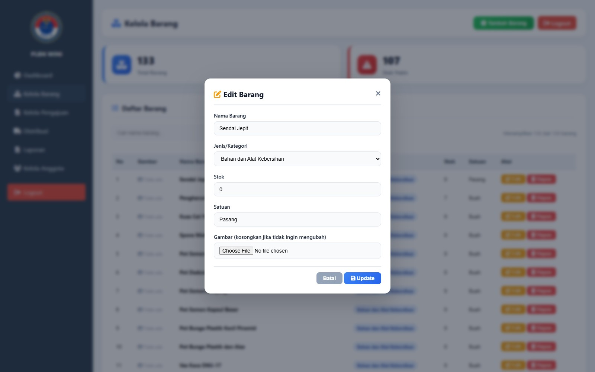

1. Pada tabel **Daftar Barang**, cari baris barang yang ingin diubah.
2. Klik **Edit**.
3. Jendela **Edit Barang** akan terbuka dan menampilkan data saat ini.
4. Ubah **Nama Barang**, **Stok**, atau **Satuan** sesuai kebutuhan.
5. Untuk mengganti gambar, klik **Choose File** dan pilih gambar baru. Jika gambar tidak ingin diubah, biarkan kolom tersebut kosong.
6. Klik **Update**.
7. Periksa pesan di bagian atas halaman dan pastikan data pada tabel sudah berubah.

Klik **Batal** atau tombol **×** untuk menutup jendela tanpa menyimpan.

### 3.3.3 Menghapus barang

1. Pada baris barang yang akan dihapus, klik **Hapus**.
2. Aplikasi menampilkan konfirmasi: *"Yakin hapus barang ini? Data tidak dapat dikembalikan."*
3. Klik **OK** untuk melanjutkan atau **Cancel** untuk membatalkan.
4. Jika berhasil, barang hilang dari tabel dan pesan **Barang berhasil dihapus.** muncul.

**Hal yang perlu diperhatikan.**

- Barang yang pernah dipakai dalam pengajuan **tidak dapat dihapus**. Aplikasi menampilkan pesan *"Barang tidak bisa dihapus karena sudah pernah digunakan dalam pengajuan."* Ini menjaga riwayat tetap utuh.
- Menghapus barang juga menghapus gambarnya dari penyimpanan dan **tidak dapat dibatalkan**.
- Menambah atau mengurangi stok secara manual di menu ini akan memengaruhi perhitungan saat pengajuan disetujui. Cocokkan selalu dengan hasil pengecekan fisik.

## 3.4 Kelola Pengajuan

**Tujuan.** Memeriksa pengajuan dari Pengguna, lalu memutuskan apakah pengajuan disetujui atau ditolak.

**Cara membuka.** Klik **Kelola Pengajuan** pada sidebar.

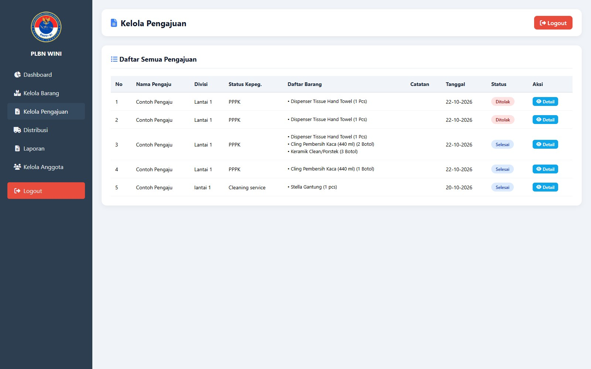

**Elemen pada halaman.**

- Tabel **Daftar Semua Pengajuan** dengan kolom **No**, **Nama Pengaju**, **Divisi**, **Status Kepeg.**, **Daftar Barang**, **Catatan**, **Tanggal**, **Status**, dan **Aksi**.
- Tombol **Detail** pada setiap baris.
- Pada pengajuan berstatus **Pending** muncul tambahan tombol **Setujui**, **Tolak**, dan **Edit**.

**Arti status.**

| Status | Arti |
|---|---|
| **Pending** | Pengajuan baru, belum diputuskan |
| **Disetujui** | Pengajuan disetujui, stok sudah dikurangi, menunggu distribusi |
| **Ditolak** | Pengajuan tidak disetujui dan tidak akan diproses |
| **Didistribusi** | Barang sudah diserahkan, menunggu bukti penerimaan dari Pengguna |
| **Selesai** | Bukti penerimaan sudah diverifikasi Admin |

### 3.4.1 Melihat detail pengajuan

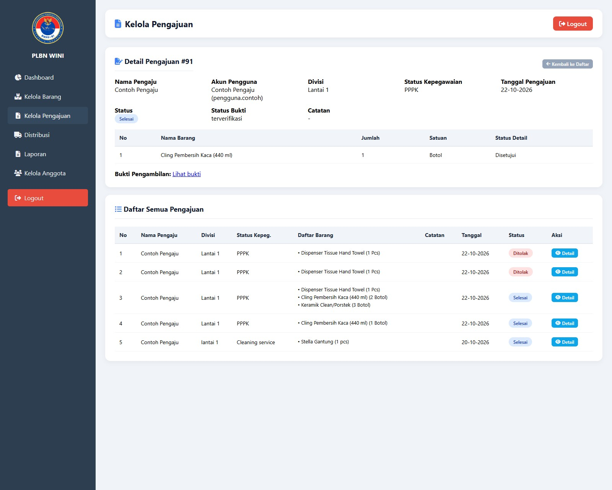

1. Klik **Detail** pada baris pengajuan.
2. Halaman **Detail Pengajuan** menampilkan nama pengaju, akun pengguna, divisi, status kepegawaian, tanggal, status, status bukti, catatan, dan tabel barang yang diajukan.
3. Jika Pengguna sudah mengunggah bukti, tautan **Lihat bukti** tersedia.
4. Klik **Kembali ke Daftar** untuk kembali ke tabel.

### 3.4.2 Menyetujui pengajuan

1. Pada baris berstatus **Pending**, klik **Setujui**.
2. Aplikasi menampilkan konfirmasi: *"Setujui pengajuan ini? Stok akan dikurangi."*
3. Klik **OK**.
4. Aplikasi mengurangi stok setiap barang sesuai jumlah yang diajukan, mengubah status menjadi **Disetujui**, dan menampilkan pesan **Pengajuan berhasil disetujui dan stok dikurangi.**
5. Lanjutkan ke menu **Distribusi** untuk mencatat penyerahan barang.

Jika stok tidak mencukupi, aplikasi menolak persetujuan dan menampilkan pesan kesalahan. Periksa stok pada menu **Kelola Barang** lebih dahulu.

> **Perhatian.** Persetujuan langsung mengurangi stok. Pastikan barang benar-benar tersedia sebelum menekan **Setujui**. Tindakan ini tidak dapat dibatalkan dari antarmuka aplikasi.

### 3.4.3 Menolak pengajuan

1. Pada baris berstatus **Pending**, klik **Tolak**.
2. Aplikasi menampilkan konfirmasi: *"Tolak pengajuan ini?"*
3. Klik **OK**.
4. Status berubah menjadi **Ditolak** dan pesan **Pengajuan ditolak.** muncul.

Penolakan tidak mengubah stok. Status **Ditolak** bersifat akhir, sehingga pengajuan tidak dapat diproses lagi.

### 3.4.4 Mengubah pengajuan yang masih menunggu

1. Pada baris berstatus **Pending**, klik **Edit**.
2. Jendela **Edit Pengajuan** terbuka dengan kolom **Nama Lengkap**, **Divisi**, **Status Kepegawaian**, **Catatan**, serta daftar barang dan jumlah.
3. Perbaiki data yang salah.
4. Gunakan tombol **+** untuk menambah baris barang dan tombol **−** untuk menghapus baris.
5. Klik **Simpan** pada jendela tersebut.
6. Periksa kembali tabel untuk memastikan perubahan tersimpan.

## 3.5 Distribusi

**Tujuan.** Mencatat bahwa barang benar-benar sudah diserahkan kepada pengaju, lalu memverifikasi bukti penerimaannya.

**Cara membuka.** Klik **Distribusi** pada sidebar.

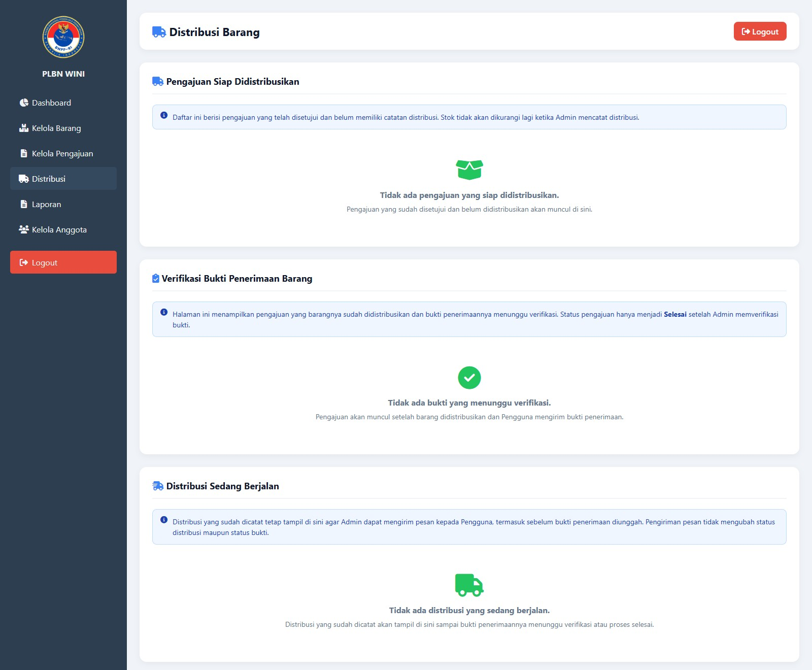

Halaman ini memiliki tiga panel:

- **Pengajuan Siap Didistribusikan** — berisi pengajuan berstatus **Disetujui** yang belum dicatat distribusinya.
- **Verifikasi Bukti Penerimaan Barang** — berisi pengajuan berstatus **Didistribusi** yang bukti penerimaannya menunggu pemeriksaan.
- **Distribusi Sedang Berjalan** — berisi pengajuan yang sudah dicatat distribusinya dan belum selesai. Panel ini tetap menampilkan pengajuan agar Admin dapat mengirim pesan kepada Pengguna.

Pada panel yang berisi data, setiap baris juga memiliki tombol **Kirim Pesan** untuk menghubungi pengaju. Pesan tersebut tampil pada menu **Pesan** milik Pengguna.

> Pada Gambar 3.7 tidak ada pengajuan yang menunggu distribusi atau verifikasi, sehingga ketiga panel tampil dalam keadaan kosong. Panel akan terisi setelah ada pengajuan yang disetujui atau didistribusikan.

### 3.5.1 Mencatat distribusi barang

1. Buka menu **Distribusi**.
2. Pada panel **Pengajuan Siap Didistribusikan**, temukan baris pengajuan yang akan diserahkan. Tabel menampilkan nomor pengajuan, nama pengaju, divisi, daftar barang, tanggal pengajuan, dan kolom aksi.
3. Jika perlu, isi **Keterangan distribusi** (opsional, maksimal 2.000 karakter), misalnya nama penerima atau lokasi penyerahan.
4. Klik **Catat Distribusi**.
5. Konfirmasi *"Catat distribusi barang untuk pengajuan #…?"* akan muncul. Klik **OK**.
6. Pengajuan berpindah dari panel distribusi dan statusnya menjadi **Didistribusi**.

**Hasil yang diharapkan.** Stok sudah berkurang sejak persetujuan, sehingga pencatatan distribusi **tidak mengurangi stok lagi**. Tugas berikutnya berada di tangan Pengguna, yaitu mengunggah bukti penerimaan.

> Jelaskan kepada Pengguna bahwa bukti penerimaan harus diunggah agar pengajuan dapat diselesaikan. Tanpa bukti, status pengajuan tetap **Didistribusi**.

### 3.5.2 Memverifikasi bukti penerimaan

1. Buka menu **Distribusi**, lalu gulir ke panel **Verifikasi Bukti Penerimaan Barang**.
2. Klik **Periksa Bukti** pada baris pengajuan yang sesuai.
3. Jendela verifikasi menampilkan foto bukti. Periksa apakah foto jelas dan menunjukkan barang yang benar.
4. Lakukan salah satu pilihan berikut:
   - **Verifikasi dan Selesaikan** — status pengajuan berubah menjadi **Selesai** dan status bukti menjadi **Terverifikasi**.
   - **Minta Perbaikan** — isi **Alasan perlu perbaikan** yang menjelaskan alasan, misalnya *"Foto kurang jelas, mohon unggah ulang."* Kolom ini wajib diisi.
5. Konfirmasi tindakan pada kotak dialog yang muncul.
6. Periksa pesan keberhasilan di bagian atas halaman.

**Jika meminta perbaikan.** Status bukti berubah menjadi **Perlu dikirim ulang**. Pengguna akan melihat catatan Anda pada halaman **Riwayat Pengajuan** dan dapat mengunggah foto baru.

> **Perhatian.** Verifikasi membuat status pengajuan menjadi **Selesai** dan pengajuan masuk ke laporan. Pastikan foto bukti benar-benar sesuai sebelum memverifikasi.

### 3.5.3 Mengirim pesan distribusi

**Tujuan.** Memberi informasi kepada pengaju, misalnya jadwal pengambilan atau pengingat unggah bukti penerimaan. Pesan ini tercatat dan dapat dibaca kembali oleh Pengguna.

**Cara membuka.** Buka menu **Distribusi**, lalu klik **Kirim Pesan** pada baris pengajuan yang dituju.

**Langkah penggunaan.**

1. Pada panel **Pengajuan Siap Didistribusikan** atau daftar distribusi berjalan, temukan pengajuan yang sesuai.
2. Klik **Kirim Pesan**.
3. Jendela **Kirim Pesan Distribusi** terbuka dan menampilkan **Tujuan Pesan**: nama penerima, username, nomor pengajuan, divisi, status pengajuan, serta nomor distribusi bila sudah ada.
4. Periksa kembali penerima pada bagian tersebut.
5. Tulis atau ubah **Isi Pesan** (wajib diisi, maksimal 2.000 karakter). Aplikasi menyiapkan templat *"Barang Anda sedang didistribusikan. Jangan lupa mengirimkan bukti penerimaan setelah barang diterima."* yang boleh disesuaikan.
6. Klik **Kirim Pesan**. Klik **Batal** untuk menutup jendela tanpa mengirim.
7. Pesan muncul di menu **Pesan** milik Pengguna dan ditandai **Belum dibaca** sampai dibuka.

**Hal yang perlu diperhatikan.**

- Pesan dapat dikirim untuk pengajuan berstatus **Disetujui** atau **Didistribusi**.
- Mengirim pesan **tidak mengubah status pengajuan**, tidak menandai bukti sudah diterima, dan tidak mengubah alur persetujuan.
- Pesan bukan pengganti pencatatan distribusi. Status tetap berubah hanya melalui tombol **Catat Distribusi** dan **Verifikasi dan Selesaikan**.

## 3.6 Laporan

**Tujuan.** Menampilkan dan mencetak rekap pengajuan yang sudah selesai dalam format resmi.

**Cara membuka.** Klik **Laporan** pada sidebar.

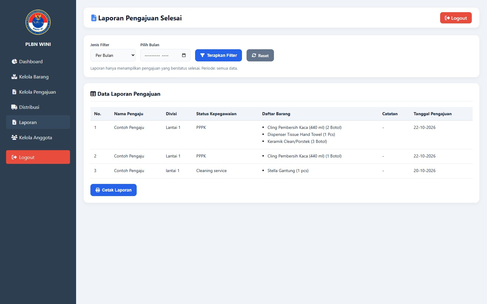

**Elemen pada halaman.**

- **Jenis Filter**: **Per Bulan**, **Per Tahun**, atau **Rentang Tanggal**.
- **Pilih Bulan** dan **Pilih Tahun** (muncul sesuai jenis filter).
- **Dari Tanggal Pengajuan** dan **Sampai Tanggal Pengajuan** (muncul untuk rentang tanggal).
- Tombol **Terapkan Filter** dan **Reset**.
- Keterangan periode aktif, misalnya *"Periode: semua data."*
- Kop laporan berisi nama instansi dan alamat.
- Tabel **Data Laporan Pengajuan**.
- Tombol **Cetak Laporan**.

**Langkah penggunaan.**

- Pilih **Jenis Filter**.
- Tentukan periode:
   - Untuk **Per Bulan**, pilih bulan pada **Pilih Bulan**.
   - Untuk **Per Tahun**, isi tahun pada **Pilih Tahun**, misalnya `2026`.
   - Untuk **Rentang Tanggal**, isi **Dari Tanggal Pengajuan** dan **Sampai Tanggal Pengajuan**.
- Klik **Terapkan Filter**.
- Periksa keterangan periode dan isi tabel. Jika ingin mengulang, klik **Reset**.
- Klik **Cetak Laporan** untuk mencetak atau menyimpan PDF. Tata cara lengkap ada di BAB V.

**Hal yang perlu diperhatikan.**

- Laporan **hanya** menampilkan pengajuan berstatus **Selesai**. Pengajuan yang masih pending, disetujui, didistribusi, atau ditolak tidak akan muncul.
- Jika tabel kosong, berarti belum ada pengajuan selesai pada periode yang dipilih.
- Jika bulan atau tahun dibiarkan kosong, aplikasi menampilkan seluruh data yang sesuai dengan jenis filter tersebut.

## 3.7 Kelola Anggota

**Tujuan.** Membuat dan merawat akun Pengguna yang dapat login ke aplikasi.

**Cara membuka.** Klik **Kelola Anggota** pada sidebar.

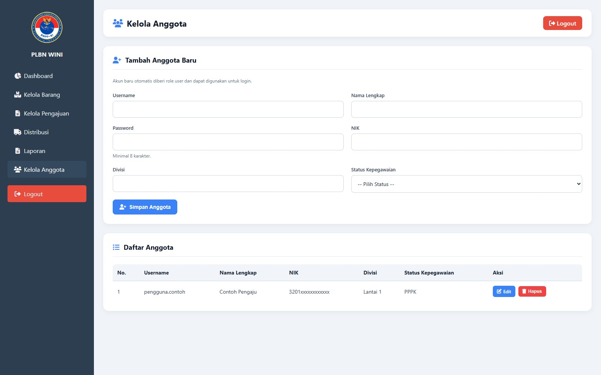

**Elemen pada halaman.**

- Formulir **Tambah Anggota Baru**.
- Tabel **Daftar Anggota** dengan kolom **No.**, **Username**, **Nama Lengkap**, **NIK**, **Divisi**, **Status Kepegawaian**, dan **Aksi**.
- Tombol **Edit** dan **Hapus** pada setiap baris.

### 3.7.1 Menambah anggota

1. Isi **Username**. Gunakan huruf kecil tanpa spasi agar mudah diingat, misalnya `budi.santoso`.
2. Isi **Nama Lengkap** sesuai data kepegawaian.
3. Isi **Password** minimal 8 karakter.
4. Isi **NIK** dengan tepat 16 angka.
5. Isi **Divisi**, misalnya `Lantai 1`.
6. Pilih **Status Kepegawaian**: PNS, PPPK, Honorer, Pegawai Kontrak, atau Pegawai Non-ASN.
7. Klik **Simpan Anggota**.
8. Akun baru otomatis memiliki hak akses **user**. Sampaikan username dan password kepada yang bersangkutan melalui saluran yang aman.

**Hasil yang diharapkan.** Anggota baru muncul pada tabel dan dapat langsung login.

### 3.7.2 Mengubah data anggota

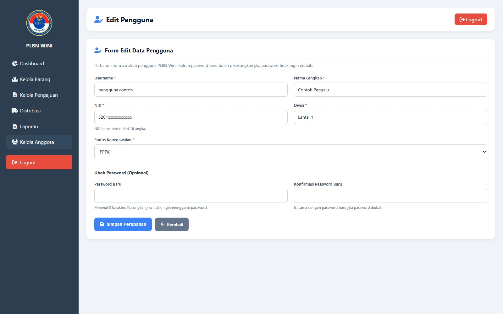

1. Pada tabel **Daftar Anggota**, klik **Edit** di baris yang dituju.
2. Halaman **Edit Pengguna** akan terbuka.
3. Ubah **Username**, **Nama Lengkap**, **NIK**, **Divisi**, atau **Status Kepegawaian** sesuai kebutuhan.
4. Untuk mengganti password, isi **Password Baru** minimal 8 karakter dan ulangi pada **Konfirmasi Password Baru**. Jika password tidak diubah, biarkan kedua kolom kosong.
5. Klik **Simpan Perubahan**.
6. Periksa pesan keberhasilan dan data pada tabel.

**Hal yang perlu diperhatikan.**

- NIK harus 16 angka. NIK juga dipakai pada layanan **Lupa Username & Password**, sehingga harus benar.
- Password baru dan konfirmasinya harus sama.
- Perubahan username akan mengubah cara Pengguna login.

### 3.7.3 Menghapus anggota

1. Klik **Hapus** pada baris anggota yang akan dihapus.
2. Konfirmasi penghapusan akan muncul. Baca dengan saksama.
3. Klik **OK** untuk melanjutkan.
4. Jika anggota tersebut sudah pernah mengajukan barang, aplikasi menolak penghapusan dan menampilkan pesan bahwa anggota masih memiliki riwayat pengajuan.
5. Jika berhasil, akun hilang dari tabel dan tidak dapat login lagi.

> **Perhatian.** Menghapus akun tidak dapat dibatalkan. Periksa kembali nama dan username sebelum menghapus. Untuk pegawai yang hanya berhenti sementara, pertimbangkan mengganti password daripada menghapus akun.

## 3.8 Hal penting yang perlu diingat Admin

- **Stok berubah pada saat persetujuan**, bukan pada saat distribusi. Periksa stok fisik sebelum menyetujui pengajuan.
- **Gunakan tombol aksi, bukan alamat halaman.** Semua tindakan penting sudah disertai konfirmasi untuk mencegah kekeliruan.
- **Verifikasi bukti hanya jika foto benar-benar sesuai.** Status **Selesai** berarti pengajuan masuk ke laporan resmi.
- **Jangan menghapus data yang masih dipakai.** Aplikasi akan menolak, tetapi tetap berhati-hatilah.
- **Periksa pesan di bagian atas halaman** setelah setiap tindakan. Pesan menunjukkan apakah tindakan berhasil atau gagal.

# BAB IV — Panduan Pengguna

Bab ini khusus untuk akun **Pengguna**. Menu yang dijelaskan hanya menu yang memang tersedia pada akun Pengguna.

## 4.1 Dashboard Pengguna

**Tujuan.** Melihat ringkasan pengajuan dan barang yang tersedia.

**Cara membuka.** Setelah login, aplikasi langsung menampilkan **Dashboard User**, atau klik **Dashboard** pada sidebar.

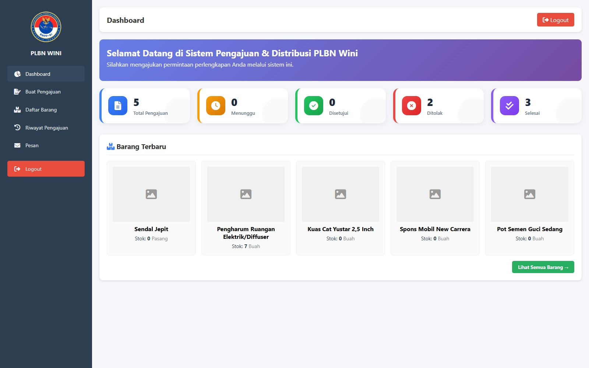

**Elemen pada halaman.**

- **Total Pengajuan**: jumlah seluruh pengajuan Anda.
- **Menunggu**: pengajuan yang belum diputuskan Admin.
- **Disetujui**: pengajuan yang sudah disetujui, termasuk yang sudah didistribusikan.
- **Ditolak**: pengajuan yang tidak disetujui.
- **Selesai**: pengajuan yang bukti penerimaannya sudah diverifikasi.
- **Barang Terbaru**: daftar barang beserta stok dan satuannya.
- **Lihat Semua Barang →**: membuka halaman **Daftar Barang**.

**Langkah penggunaan.**

1. Buka **Dashboard**.
2. Periksa kartu statistik untuk mengetahui posisi pengajuan Anda.
3. Gulir ke **Barang Terbaru** untuk melihat stok singkat.
4. Klik **Lihat Semua Barang →** bila ingin mencari barang tertentu.

## 4.2 Daftar Barang

**Tujuan.** Melihat seluruh barang yang dikelola Admin beserta sisa stoknya sebelum mengajukan.

**Cara membuka.** Klik **Daftar Barang** pada sidebar.

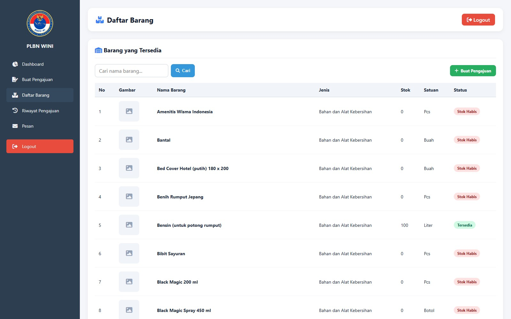

**Elemen pada halaman.**

- Kolom pencarian dengan tombol **Cari**.
- Tombol **Reset** untuk menghapus kata kunci.
- Tombol **Buat Pengajuan**.
- Tabel berisi **No**, **Gambar**, **Nama Barang**, **Stok**, **Satuan**, dan **Status**.

**Langkah mencari barang.**

1. Klik kolom **Cari nama barang...**.
2. Ketik sebagian nama barang, misalnya `sabun`.
3. Klik **Cari**.
4. Aplikasi menampilkan barang yang namanya sesuai.
5. Klik **Reset** untuk kembali menampilkan semua barang.

**Membaca status barang.**

| Status | Arti |
|---|---|
| **Tersedia** | Stok masih ada dan dapat diajukan |
| **Stok Habis** | Stok 0. Pengajuan dapat dikirim, tetapi kemungkinan besar tidak dapat disetujui sampai stok diisi kembali |

## 4.3 Membuat pengajuan

**Tujuan.** Mengirim permintaan perlengkapan secara resmi melalui sistem.

**Cara membuka.** Klik **Buat Pengajuan** pada sidebar, atau klik **Buat Pengajuan** pada halaman **Daftar Barang**.

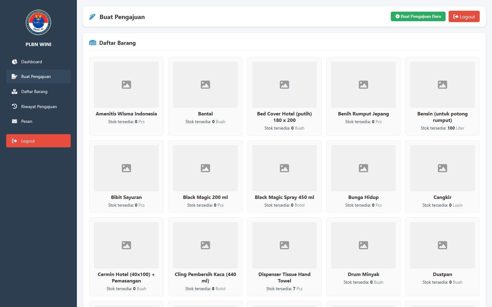

Saat pertama dibuka, halaman menampilkan daftar barang dan tombol **Buat Pengajuan Baru**. Klik tombol tersebut untuk membuka formulir.

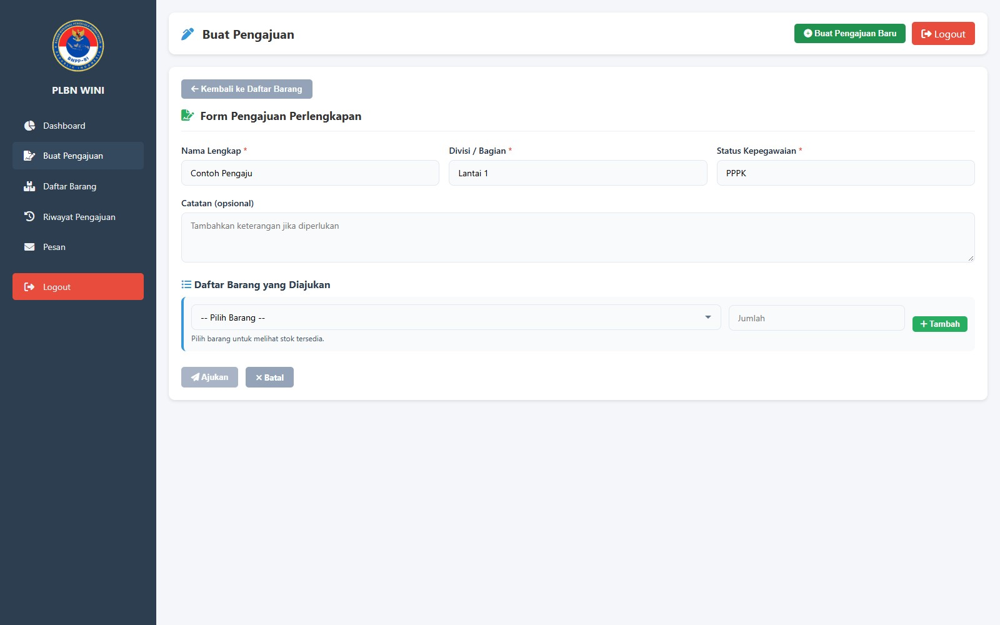

**Elemen pada formulir.**

| Kolom | Keterangan |
|---|---|
| **Nama Lengkap** | Terisi otomatis dari akun Anda. Dapat disesuaikan, maksimal 100 karakter |
| **Divisi / Bagian** | Terisi otomatis dari data akun. Wajib diisi |
| **Status Kepegawaian** | Terisi otomatis dari data akun, misalnya PPPK. Wajib diisi |
| **Catatan (opsional)** | Keterangan tambahan, maksimal 5.000 karakter |
| **Daftar Barang yang Diajukan** | Pilih barang, isi jumlah, lalu klik **Tambah** |
| **Ajukan** | Mengirim pengajuan |
| **Batal** | Kembali ke daftar barang tanpa mengirim |

**Langkah membuat pengajuan.**

1. Buka menu **Buat Pengajuan**, lalu klik **Buat Pengajuan Baru**.
2. Periksa **Nama Lengkap**, **Divisi / Bagian**, dan **Status Kepegawaian**. Perbaiki jika ada yang tidak sesuai.
3. Isi **Catatan** bila perlu, misalnya *"Untuk kebersihan lantai 1"*.
4. Pada bagian **Daftar Barang yang Diajukan**:
   - Klik daftar pilihan barang, lalu pilih satu barang.
   - Isi **Jumlah** minimal 1.
   - Klik **Tambah** bila ingin mengajukan lebih dari satu jenis barang.
   - Ulangi untuk barang berikutnya. Gunakan tombol hapus baris bila salah memilih.
5. Periksa kembali seluruh data dan rincian barang.
6. Klik **Ajukan**.
7. Jika berhasil, aplikasi menampilkan pesan **Pengajuan berhasil dikirim! Menunggu persetujuan admin.** dan Anda diarahkan ke halaman **Riwayat Pengajuan**.

**Hal yang perlu diperhatikan.**

- Pengajuan tidak dapat dikirim jika belum ada barang yang dipilih atau jumlahnya kurang dari 1.
- Barang yang sama yang dipilih dua kali akan digabung jumlahnya oleh sistem.
- Stok **tidak langsung** berkurang saat pengajuan dikirim. Stok baru berkurang ketika Admin menyetujui.
- Mengajukan barang dengan stok 0 tetap dapat dilakukan, tetapi pengajuan akan gagal disetujui sampai stok tersedia.

## 4.4 Riwayat Pengajuan

**Tujuan.** Memantau semua pengajuan Anda, melihat statusnya, menghapus pengajuan yang belum diproses, dan mengunggah bukti penerimaan.

**Cara membuka.** Klik **Riwayat** pada sidebar (pada halaman lain, namanya **Riwayat Pengajuan**).

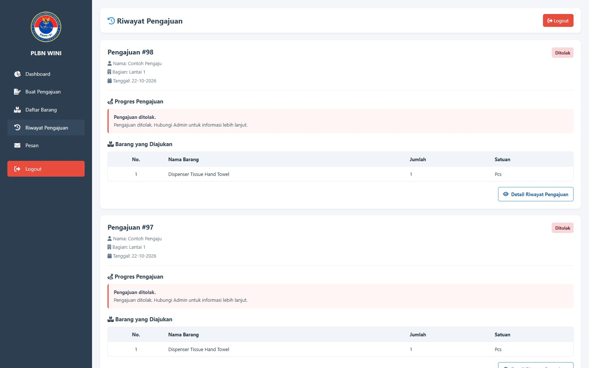

**Elemen pada halaman.**

- Kartu untuk setiap pengajuan berisi nomor pengajuan, nama, bagian, tanggal, dan status.
- Keterangan singkat sesuai status, misalnya *"Pengajuan berhasil diselesaikan."*
- Tombol **Detail Riwayat** (muncul pada pengajuan berstatus **Selesai**).
- Formulir **Bukti Penerimaan Barang** (muncul pada pengajuan berstatus **Didistribusi** yang buktinya belum dikirim atau perlu dikirim ulang).
- Tombol **Hapus Pengajuan** (hanya untuk pengajuan yang masih menunggu).

**Arti status pengajuan.**

| Status | Arti | Tindakan Pengguna |
|---|---|---|
| **Pending / Menunggu** | Belum diputuskan Admin | Tunggu, atau hapus jika ingin membatalkan |
| **Disetujui** | Disetujui, menunggu penyerahan barang | Tunggu distribusi |
| **Ditolak** | Tidak disetujui | Tidak ada. Hubungi Admin bila perlu penjelasan |
| **Didistribusi** | Barang sudah diserahkan | Unggah bukti penerimaan |
| **Selesai** | Bukti sudah diverifikasi | Selesai |

### 4.4.1 Melihat detail riwayat

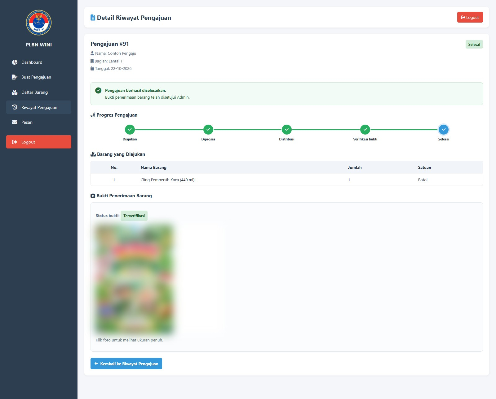

1. Pada kartu pengajuan, klik **Detail Riwayat**.
2. Halaman **Detail Riwayat** menampilkan:
   - nomor pengajuan, nama, bagian, tanggal, dan status;
   - **Progres Pengajuan**: Diajukan → Diproses → Distribusi → Verifikasi bukti → Selesai;
   - tabel **Barang yang Diajukan**;
   - **Bukti Penerimaan Barang** beserta statusnya.
3. Klik foto bukti untuk melihat ukuran penuh.
4. Klik **Kembali ke Riwayat** untuk kembali.

Halaman detail hanya dapat dibuka untuk pengajuan milik Anda sendiri dan yang sudah berstatus **Selesai**.

### 4.4.2 Menghapus pengajuan yang belum diproses

1. Pada kartu pengajuan berstatus **Pending**, klik **Hapus Pengajuan**.
2. Konfirmasi *"Yakin ingin menghapus pengajuan ini?"* muncul.
3. Klik **OK**.
4. Pengajuan hilang dari daftar dan pesan **Pengajuan berhasil dihapus.** muncul.

**Hal yang perlu diperhatikan.**

- Pengajuan yang sudah diproses Admin tidak dapat dihapus. Aplikasi menampilkan pesan *"Pengajuan tidak dapat dihapus karena sudah diproses."*
- Penghapusan bersifat permanen dan tidak dapat dibatalkan.

### 4.4.3 Mengunggah bukti penerimaan

Formulir unggah bukti muncul pada kartu pengajuan berstatus **Didistribusi** yang buktinya belum dikirim atau perlu dikirim ulang.

1. Siapkan foto barang yang sudah diterima. Pastikan foto jelas dan memperlihatkan barang serta jumlahnya.
2. Pada kartu pengajuan, temukan bagian **Bukti Penerimaan Barang**.
3. Klik **Choose File** (atau tombol sejenis), lalu pilih foto.
4. Klik **Kirim Bukti Penerimaan** (atau **Kirim Ulang Bukti** jika sebelumnya diminta perbaikan).
5. Jika berhasil, muncul pesan **Bukti penerimaan berhasil dikirim. Tunggu verifikasi Admin.** dan status bukti berubah menjadi **Menunggu verifikasi**.

**Ketentuan foto.**

| Ketentuan | Nilai |
|---|---|
| Format | JPG, PNG, atau WEBP |
| Ukuran maksimal | 5 MB |
| Waktu unggah | Setelah Admin mencatat distribusi dan sebelum bukti diverifikasi |

**Status bukti yang mungkin muncul.**

| Status bukti | Arti |
|---|---|
| **Belum dikirim** | Belum ada bukti yang diunggah |
| **Menunggu verifikasi** | Bukti sudah dikirim dan sedang diperiksa Admin |
| **Terverifikasi** | Bukti disetujui, pengajuan selesai |
| **Perlu dikirim ulang** | Admin meminta perbaikan. Baca catatan dari Admin, lalu unggah foto baru |

Jika Admin meminta perbaikan, catatan dari Admin ditampilkan pada kartu pengajuan. Perbaiki sesuai catatan, lalu unggah ulang.

### 4.4.4 Tampilan pengajuan yang sudah selesai

Setelah Admin memverifikasi bukti, kartu pengajuan berubah menjadi hijau dengan status **Selesai** dan keterangan **"Pengajuan berhasil diselesaikan."** serta **"Bukti penerimaan barang telah disetujui Admin."**

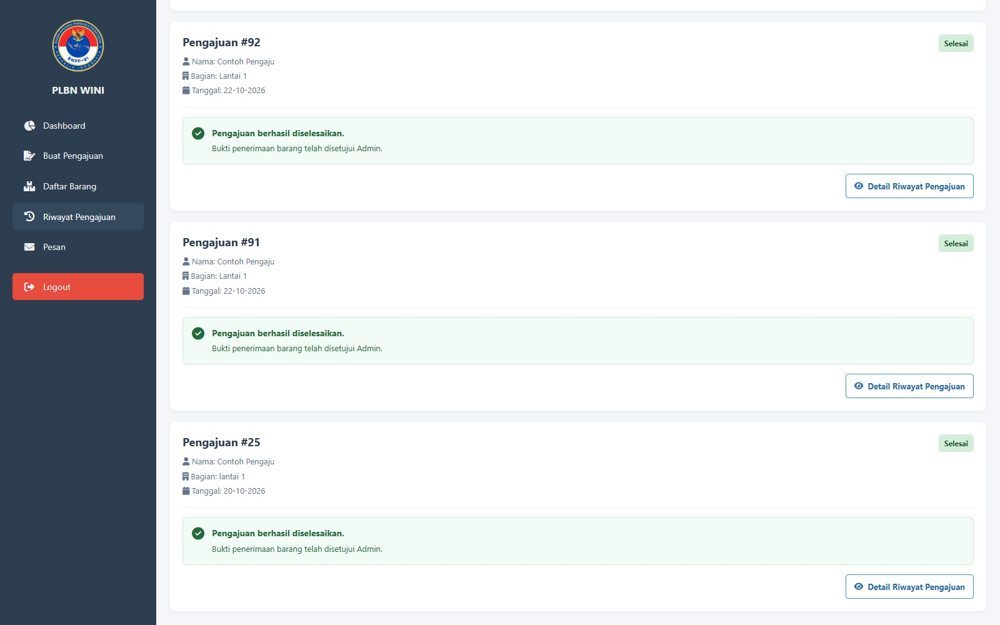

Pada tahap ini:

- formulir unggah bukti dan tombol **Hapus Pengajuan** tidak lagi ditampilkan;
- tombol **Detail Riwayat Pengajuan** tersedia untuk melihat rincian;
- pengajuan sudah tercatat pada **Laporan** Admin dan tidak dapat diubah lagi oleh Pengguna.

## 4.5 Pesan dari Admin

**Tujuan.** Membaca pesan yang dikirim Admin melalui menu **Distribusi**, misalnya pemberitahuan bahwa barang sedang diserahkan atau pengingat untuk mengunggah bukti penerimaan.

**Cara membuka.** Klik **Pesan** pada sidebar. Menu ini hanya berisi pesan milik akun Anda.

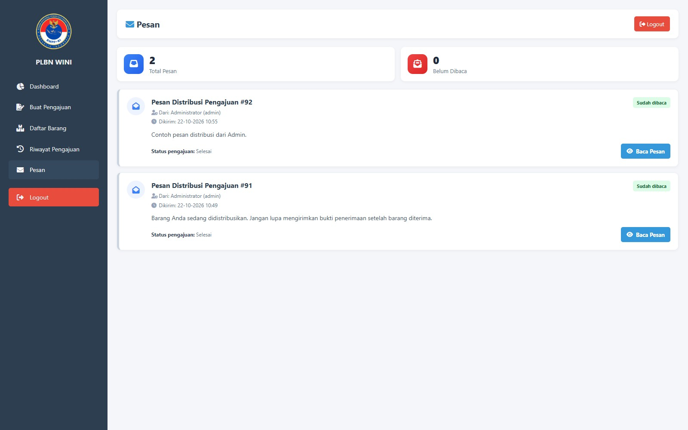

**Elemen pada halaman.**

- **Total Pesan**: jumlah seluruh pesan yang pernah diterima.
- **Belum Dibaca**: jumlah pesan yang belum dibuka.
- Kartu pesan berisi judul **Pesan Distribusi Pengajuan #…**, nama Admin pengirim, waktu kirim, ringkasan isi, status pengajuan, dan tombol **Baca Pesan**.
- Penanda **Belum dibaca** atau **Sudah dibaca** pada setiap kartu.

**Langkah membaca pesan.**

1. Buka menu **Pesan**.
2. Perhatikan jumlah **Belum Dibaca** dan kartu yang ditandai **Belum dibaca**.
3. Klik **Baca Pesan** pada kartu yang ingin dibuka.
4. Halaman **Detail Pesan** menampilkan isi lengkap, waktu kirim, waktu baca, status pengajuan, status bukti penerimaan, tanggal pengajuan, dan nomor distribusi.
5. Baca **Keterangan Distribusi dari Admin** bila ada. Jika pengajuan masih **Didistribusi**, halaman juga menampilkan **Tindakan Berikutnya**, yaitu mengunggah bukti melalui **Riwayat Pengajuan**.
6. Gunakan tombol **Kembali ke Pesan**, **Riwayat Pengajuan**, atau **Detail Pengajuan** (muncul bila pengajuan sudah **Selesai**).

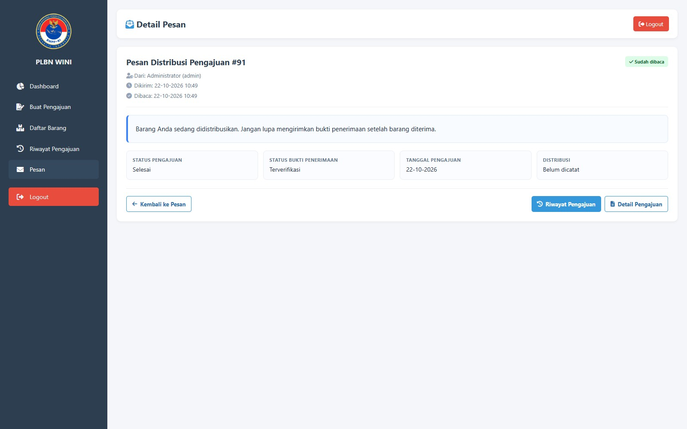

**Hal yang perlu diperhatikan.**

- Membuka pesan otomatis menandainya **Sudah dibaca** dan mengurangi jumlah **Belum Dibaca**.
- Pesan bersifat satu arah. Aplikasi **tidak menyediakan tombol balas**; sampaikan tanggapan kepada Admin melalui saluran resmi kantor.
- Pesan hanya sebagai pemberitahuan. Status pengajuan tetap berubah melalui persetujuan, distribusi, dan verifikasi Admin, bukan melalui pesan.
- Jumlah pesan yang tampil adalah pesan yang tersimpan untuk akun Anda. Pesan tidak dapat dihapus dari halaman ini.

## 4.6 Pertanyaan yang Sering Diajukan

**Apakah pengajuan bisa dibatalkan?**

Bisa, selama statusnya masih **Pending**. Buka **Riwayat Pengajuan**, lalu klik **Hapus Pengajuan**. Setelah Admin memproses pengajuan, tombol tersebut tidak tersedia lagi.

**Mengapa stok barang tidak berkurang saat saya mengirim pengajuan?**

Stok baru berkurang ketika Admin menyetujui pengajuan. Selama status masih **Pending**, stok belum berubah.

**Bisakah saya mengubah jumlah barang setelah pengajuan dikirim?**

Dari akun Pengguna, pengajuan yang sudah dikirim tidak dapat diubah. Hubungi Admin; Admin dapat mengubah pengajuan yang masih berstatus **Pending** melalui tombol **Edit** pada menu **Kelola Pengajuan**.

**Mengapa formulir unggah bukti belum muncul?**

Formulir bukti hanya muncul setelah Admin mencatat distribusi, yaitu ketika status pengajuan menjadi **Didistribusi**. Jika status bukti sudah **Terverifikasi** atau sedang **Menunggu verifikasi**, formulir juga tidak ditampilkan.

**Bukti saya diminta diperbaiki. Apa yang harus dilakukan?**

Baca catatan dari Admin pada kartu pengajuan. Status bukti akan menjadi **Perlu dikirim ulang**. Siapkan foto baru yang lebih jelas, lalu unggah kembali melalui formulir yang sama.

**Apakah status Selesai dapat dibatalkan sendiri?**

Tidak. Status **Selesai** hanya berubah melalui verifikasi Admin. Jika ada kekeliruan, hubungi Admin untuk diperiksa.

**Bisakah saya membalas pesan dari Admin melalui aplikasi?**

Tidak. Menu **Pesan** hanya untuk membaca pesan. Aplikasi belum menyediakan tombol balas atau percakapan dua arah. Hubungi Admin melalui saluran resmi kantor bila perlu menanggapi pesan.

## 4.7 Logout

1. Klik **Logout** pada sidebar atau sudut kanan atas.
2. Aplikasi kembali ke halaman login.

Selalu logout bila menggunakan komputer bersama.

# BAB V — Panduan Melihat Laporan dan Mencetak

Menu **Laporan** hanya tersedia untuk Admin. Pengguna tidak dapat membuka menu ini.

## 5.1 Membuka halaman laporan

1. Login sebagai Admin.
2. Klik **Laporan** pada sidebar.
3. Halaman **Laporan Pengajuan Selesai** akan terbuka. Tampilannya sama seperti Gambar 3.8 pada BAB III.

## 5.2 Memilih periode dan filter

1. Pilih **Jenis Filter**:
   - **Per Bulan** — laporan satu bulan tertentu.
   - **Per Tahun** — laporan satu tahun tertentu.
   - **Rentang Tanggal** — laporan antara dua tanggal.
2. Lengkapi pilihan yang muncul:
   - **Pilih Bulan** untuk filter bulanan.
   - **Pilih Tahun** untuk filter tahunan, misalnya `2026`.
   - **Dari Tanggal Pengajuan** dan **Sampai Tanggal Pengajuan** untuk rentang tanggal.
3. Klik **Terapkan Filter**.
4. Periksa keterangan periode di bawah pilihan filter.
5. Klik **Reset** untuk mengembalikan tampilan ke semua data.

## 5.3 Membaca hasil laporan

Tabel **Data Laporan Pengajuan** memuat kolom **No.**, **Nama Pengaju**, **Divisi**, **Status Kepegawaian**, **Daftar Barang**, **Catatan**, dan **Tanggal Pengajuan**.

Yang perlu diperhatikan:

- Hanya pengajuan berstatus **Selesai** yang tampil.
- Baris bernomor urut dan tanggal ditulis dalam format **hari-bulan-tahun**, misalnya `20-10-2026`.
- Jika tabel kosong, belum ada pengajuan selesai pada periode tersebut.

## 5.4 Mencetak laporan

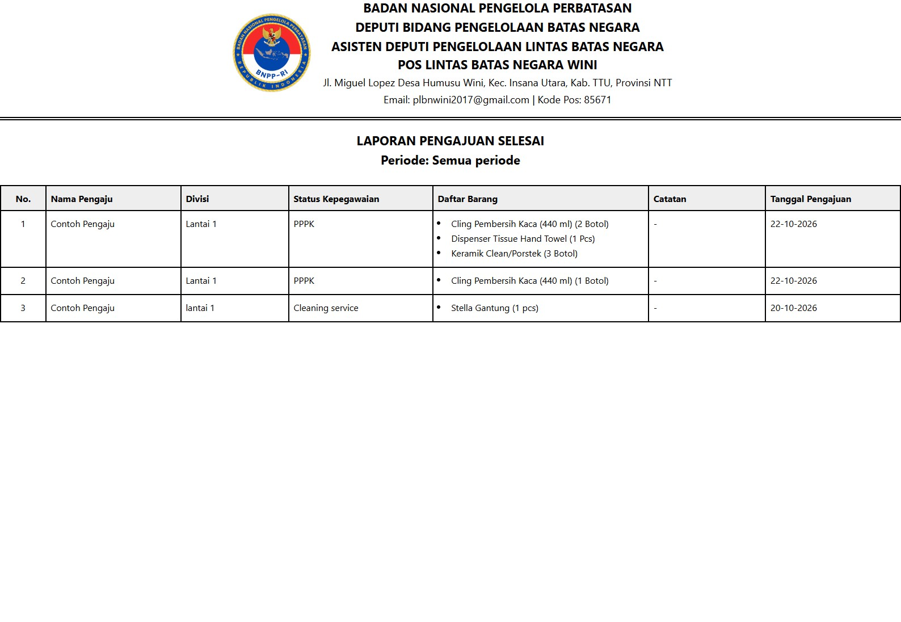

Tampilan cetak berbeda dari tampilan layar: sidebar, filter, dan tombol tidak ikut tercetak. Yang tercetak hanya kop instansi, judul laporan, periode, dan tabel data.

1. Siapkan filter sesuai kebutuhan.
2. Klik **Cetak Laporan**. Jendela cetak browser akan terbuka.
3. Pada **Destination** (tujuan), pilih printer yang tersedia.
4. Buka **More settings** (Pengaturan lainnya), lalu sesuaikan:
   - **Paper size**: **A4**
   - **Layout**: **Portrait**
   - **Margins**: **Default**
   - **Scale**: **Default** atau **100%**
   - **Background graphics**: **dicentang** agar warna, garis kop, dan bayangan tabel ikut tercetak
   - **Headers and footers**: **tidak dicentang**, karena kop sudah disediakan aplikasi
5. Periksa pratinjau di sisi kanan.
6. Klik **Print**.

**Menyimpan laporan sebagai PDF.**

1. Pada jendela cetak, pilih **Destination: Save as PDF**.
2. Klik **Save**.
3. Tentukan folder dan nama berkas, misalnya `Laporan-Pengajuan-Oktober-2026.pdf`.
4. Klik **Save** kembali.

## 5.5 Mengatasi hasil cetak yang tidak sesuai

| Gejala | Penyebab umum | Langkah penyelesaian |
|---|---|---|
| Tabel terpotong di tepi kanan | Skala terlalu besar atau ukuran kertas bukan A4 | Pilih **A4**, **Portrait**, dan **Scale: Default** |
| Logo tidak muncul | Berkas logo tidak termuat saat halaman dicetak | Muat ulang halaman laporan, lalu klik **Cetak Laporan** kembali. Jika tetap tidak muncul, hubungi Admin untuk memeriksa berkas logo pada server |
| Halaman pertama berisi sidebar atau tombol | Halaman yang dicetak bukan hasil tombol **Cetak Laporan** | Tutup jendela cetak, klik **Cetak Laporan** dari halaman laporan |
| Data tidak lengkap | Filter periode terlalu sempit | Longgarkan filter atau pilih **Rentang Tanggal** yang lebih luas |
| Laporan kosong | Belum ada pengajuan berstatus **Selesai** | Periksa status pengajuan melalui menu **Kelola Pengajuan** |
| Warna kop pudar | Printer hitam-putih | Gunakan printer warna, atau simpan sebagai PDF agar tampilan tetap berwarna |

> Jika logo tetap tidak muncul setelah halaman dimuat ulang, hubungi Admin untuk memeriksa berkas logo pada server. Jangan mengubah pengaturan server tanpa panduan.

# BAB VI — Alur Kerja Sistem

Bab ini merangkum perjalanan satu pengajuan dari dikirim sampai masuk laporan, serta siapa yang bertindak pada setiap tahap. Alur disusun dari aturan yang benar-benar diterapkan aplikasi, termasuk perubahan stok dan syarat verifikasi bukti.

## 6.1 Alur utama pengajuan barang

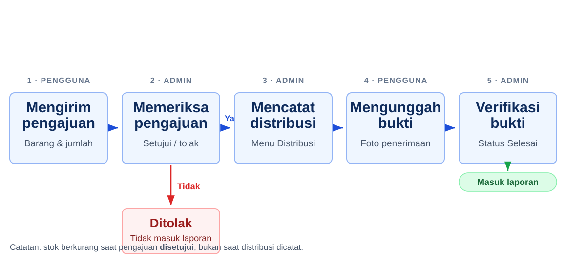

1. **Pengguna mengirim pengajuan.** Pengguna memilih barang dan jumlah pada menu **Buat Pengajuan**, lalu menekan **Ajukan**. Status awal adalah **Menunggu** dan stok belum berubah.
2. **Admin memeriksa.** Admin membuka **Kelola Pengajuan**, melihat rincian barang, dan memeriksa ketersediaan stok fisik.
3. **Admin memutuskan.** Jika disetujui, sistem mengurangi stok sesuai jumlah yang disetujui dan status menjadi **Disetujui**. Jika ditolak, status menjadi **Ditolak** dan pengajuan tidak masuk laporan.
4. **Admin mencatat distribusi.** Setelah barang benar-benar diserahkan, Admin menekan **Catat Distribusi** pada menu **Distribusi**. Status menjadi **Didistribusi**; stok tidak dikurangi lagi.
5. **Pengguna mengunggah bukti.** Pengguna memotret barang yang diterima dan mengirimkannya melalui **Riwayat Pengajuan**. Status bukti menjadi **Menunggu verifikasi**, sedangkan status pengajuan tetap **Didistribusi**.
6. **Admin memverifikasi.** Admin memeriksa foto pada panel **Verifikasi Bukti Penerimaan Barang**. Jika sesuai, status menjadi **Selesai** dan pengajuan masuk ke **Laporan**. Jika tidak sesuai, Admin meminta perbaikan dan Pengguna mengunggah ulang.

> **Titik kritis.** Stok berkurang pada langkah 3, bukan langkah 4. Karena itu, periksa stok fisik sebelum menyetujui. Pengajuan yang sudah **Selesai** tidak dapat dikembalikan ke tahap sebelumnya melalui aplikasi.

## 6.2 Perubahan status pengajuan

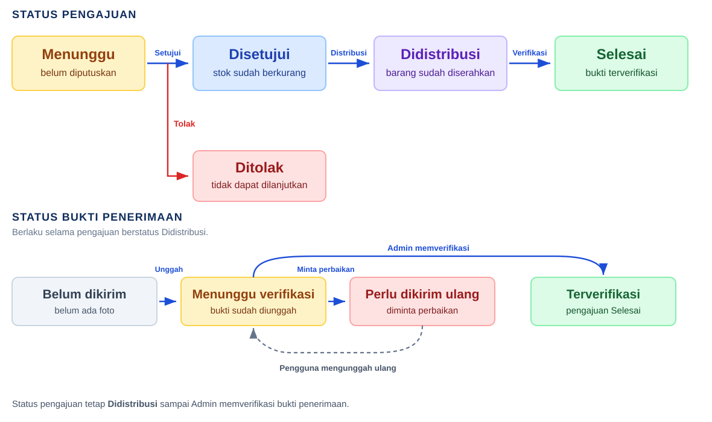

| Dari status | Ke status | Dilakukan oleh | Syarat / tindakan |
|---|---|---|---|
| **Menunggu** | **Disetujui** | Admin | Menekan **Setujui**; stok mencukupi; stok langsung dikurangi |
| **Menunggu** | **Ditolak** | Admin | Menekan **Tolak**; alasan dapat ditulis pada catatan |
| **Menunggu** | *Data dihapus* | Pengguna | Menekan **Hapus Pengajuan** selama belum diproses Admin |
| **Disetujui** | **Didistribusi** | Admin | Menekan **Catat Distribusi** setelah barang diserahkan |
| **Didistribusi** | **Selesai** | Admin | Menekan **Verifikasi dan Selesaikan**; hanya tersedia bila bukti berstatus **Menunggu verifikasi** |
| **Ditolak** | — | — | Status akhir; tidak dapat dilanjutkan |
| **Selesai** | — | — | Status akhir; masuk ke laporan |

**Status bukti penerimaan** berjalan di dalam status pengajuan **Didistribusi**:

- **Belum dikirim** → Pengguna mengunggah foto → **Menunggu verifikasi**.
- **Menunggu verifikasi** → Admin menyetujui → **Terverifikasi** dan pengajuan menjadi **Selesai**.
- **Menunggu verifikasi** → Admin meminta perbaikan → **Perlu dikirim ulang** → Pengguna mengunggah ulang → **Menunggu verifikasi**.

Admin tidak dapat memverifikasi bukti yang belum dikirim, dan Pengguna tidak dapat mengunggah bukti baru ketika bukti sedang menunggu verifikasi atau sudah terverifikasi.

## 6.3 Alur pesan distribusi

Pesan distribusi adalah pemberitahuan satu arah dan **bukan bagian dari perubahan status**.

1. Admin membuka **Distribusi** dan menekan **Kirim Pesan** pada pengajuan berstatus **Disetujui** atau **Didistribusi**.
2. Admin memeriksa penerima, menyesuaikan **Isi Pesan**, lalu menekan **Kirim Pesan**.
3. Pesan tersimpan dan muncul pada menu **Pesan** milik Pengguna dengan penanda **Belum dibaca**.
4. Pengguna membuka **Baca Pesan**. Aplikasi mencatat waktu baca dan menandai pesan **Sudah dibaca**.
5. Pesan tetap tersimpan sebagai riwayat komunikasi, tetapi tidak mengubah status pengajuan maupun status bukti.

## 6.4 Ringkasan tanggung jawab per tahap

| Tahap | Pengguna | Admin | Hasil |
|---|---|---|---|
| Pengajuan | Memilih barang, mengisi jumlah, mengirim | — | Status **Menunggu** |
| Pemeriksaan | Menunggu atau menghapus pengajuan | Membuka detail dan memeriksa stok | Keputusan Admin |
| Persetujuan | — | Menyetujui atau menolak | **Disetujui** / **Ditolak**; stok berkurang bila disetujui |
| Distribusi | Menerima barang | Mencatat distribusi dan dapat mengirim pesan | Status **Didistribusi** |
| Bukti | Mengunggah foto penerimaan | Memeriksa bukti | **Menunggu verifikasi** |
| Verifikasi | Menunggu hasil | Memverifikasi atau meminta perbaikan | **Selesai** atau **Perlu dikirim ulang** |
| Pelaporan | — | Mencetak laporan pengajuan selesai | Laporan A4 |

# BAB VII — Mengatasi Masalah Umum

Bab ini membantu Anda mengenali masalah yang sering terjadi dan menentukan apakah masalah dapat diselesaikan sendiri atau perlu bantuan Admin. Gunakan tabel berikut sebagai panduan awal.

**Tabel 7.1 — Masalah umum dan cara mengatasinya**

| Masalah | Kemungkinan penyebab | Langkah penyelesaian |
|---|---|---|
| Tidak dapat login, pesan **Username atau password salah** | Salah ketik, Caps Lock aktif, atau password sudah diubah | **Anda sendiri:** periksa Caps Lock, ketik ulang password, gunakan ikon mata untuk melihat isi kolom. Jika tetap gagal, gunakan **Lupa Username & Password?**. **Admin:** periksa akun pada menu **Kelola Anggota** dan ganti password bila perlu |
| Tidak dapat login, pesan **Akun ini tidak memiliki akses ke sistem** | Jenis akun tidak dikenali aplikasi | **Admin:** buka **Kelola Anggota**, pastikan akun berjenis pengguna, lalu buat ulang akun bila perlu |
| Tidak dapat login, pesan **Terjadi kesalahan pada sistem** | Aplikasi tidak dapat terhubung ke database | **Anda sendiri:** tunggu beberapa saat, muat ulang halaman, lalu coba lagi. **Admin:** periksa layanan database dan hubungi pengelola server |
| Menu yang dicari tidak muncul | Akun tidak memiliki hak akses, sidebar tertutup, atau halaman diperkecil | **Anda sendiri:** pastikan sudah login dengan akun yang benar, klik tombol menu di kiri atas, kembalikan zoom browser ke 100%. **Admin:** periksa jenis akun |
| Data yang dicari tidak ditemukan | Kata kunci salah, filter terlalu sempit, atau data memang belum ada | **Anda sendiri:** hapus kata kunci (klik **Reset** bila tersedia), longgarkan filter, atau periksa ejaan. **Admin:** pastikan data benar-benar tersimpan |
| Formulir gagal disimpan | Ada kolom wajib yang kosong, jumlah kurang dari 1, NIK bukan 16 angka, atau password kurang dari 8 karakter | **Anda sendiri:** baca pesan kesalahan, lengkapi kolom yang ditandai, lalu simpan kembali |
| Pengajuan gagal disetujui | Stok tidak mencukupi | **Admin:** periksa stok pada **Kelola Barang**, tambah stok bila barang tersedia, lalu setujui kembali. **Pengguna:** kurangi jumlah atau tunggu stok tersedia |
| Status pengajuan tidak berubah setelah bukti diunggah | Bukti masih menunggu pemeriksaan Admin | **Anda sendiri:** lihat status bukti pada **Riwayat Pengajuan**. Jika **Menunggu verifikasi**, tunggu pemeriksaan. **Admin:** buka menu **Distribusi** dan verifikasi bukti |
| Bukti penerimaan gagal diunggah | Format bukan JPG/PNG/WEBP atau ukuran lebih dari 5 MB | **Anda sendiri:** ubah format atau perkecil foto, lalu unggah ulang |
| Pengajuan tidak dapat dihapus | Pengajuan sudah diproses Admin | **Anda sendiri:** pengajuan yang sudah diproses memang tidak dapat dihapus. Hubungi Admin bila ada kekeliruan |
| Halaman tidak dapat dibuka atau tampil kosong | Alamat salah, server mati, atau koneksi terputus | **Anda sendiri:** periksa alamat, koneksi jaringan, dan muat ulang halaman. **Admin:** pastikan server aplikasi dan database menyala |
| Tampilan halaman tidak normal | Zoom browser terlalu besar/kecil atau cache lama | **Anda sendiri:** tekan **Ctrl+0** untuk mengembalikan zoom, muat ulang dengan **Ctrl+F5**, atau coba browser lain |
| Laporan tidak dapat dicetak | Printer belum siap atau jendela cetak tertutup | **Anda sendiri:** klik **Cetak Laporan** lagi, pilih printer yang aktif, atau simpan sebagai PDF |
| Laporan kosong | Belum ada pengajuan **Selesai** pada periode itu | **Admin:** longgarkan filter dan pastikan pengajuan sudah diverifikasi |
| Halaman login terus muncul kembali | Sesi berakhir karena halaman terlalu lama dibiarkan | **Anda sendiri:** login kembali. Sesi yang berakhir otomatis adalah hal normal |

**Cara membedakan masalah Anda dan masalah Admin.**

- **Dapat ditangani sendiri:** salah ketik, lupa password (melalui pemulihan NIK), filter atau pencarian, unggah foto yang terlalu besar, dan pengaturan cetak.
- **Perlu bantuan Admin:** akun tidak aktif atau salah jenis, data stok tidak sesuai, status pengajuan tidak berubah setelah waktunya, bukti ditolak tanpa catatan, dan laporan yang tidak sesuai data.
- **Perlu bantuan pengelola sistem:** halaman tidak dapat dibuka sama sekali, pesan kesalahan database, atau tampilan rusak pada banyak halaman.

> **Jangan mencoba memperbaiki sendiri dengan menghapus data, mengubah file aplikasi, atau mengubah database.** Tindakan tersebut berisiko menghilangkan riwayat pengajuan dan tidak diperlukan untuk penggunaan sehari-hari.

# BAB VIII — Tips Penggunaan yang Aman

## 8.1 Untuk semua pengguna

- **Gunakan password yang kuat.** Minimal 8 karakter, gabungkan huruf besar, huruf kecil, dan angka. Jangan memakai tanggal lahir atau nama sendiri.
- **Jangan berbagi akun.** Setiap pengajuan tercatat atas nama akun yang dipakai. Akun bersama membuat riwayat tidak akurat.
- **Selalu logout** setelah selesai, terutama di komputer bersama atau komputer layanan umum.
- **Periksa alamat situs.** Pastikan alamat yang dibuka benar. Jangan memasukkan password pada halaman yang tampilannya berbeda dari Gambar 2.1.
- **Waspadai permintaan password.** Admin tidak pernah meminta password melalui telepon, pesan singkat, atau pesan aplikasi.
- **Simpan bukti pengajuan.** Setelah mengirim pengajuan, buka **Riwayat Pengajuan** dan pastikan datanya benar. Screenshot halaman riwayat dapat dijadikan arsip pribadi.
- **Jaga kerahasiaan NIK.** NIK dipakai untuk pemulihan akun. Jangan membagikannya tanpa keperluan.
- **Gunakan komputer yang tepercaya.** Hindari login pada komputer bersama tanpa mengakhiri sesi, dan jangan menyimpan password di browser publik.

## 8.2 Khusus Admin

- **Periksa stok fisik sebelum menyetujui pengajuan.** Stok berkurang saat persetujuan, bukan saat distribusi.
- **Catat distribusi segera setelah barang diserahkan.** Pengajuan yang belum dicatat akan tetap berada di daftar distribusi.
- **Verifikasi bukti dengan teliti.** Status **Selesai** berarti pengajuan masuk ke laporan resmi dan sulit ditarik kembali.
- **Hindari menghapus barang atau anggota yang memiliki riwayat.** Aplikasi menolak, tetapi pemeriksaan awal lebih baik.
- **Gunakan kolom Catatan untuk informasi penting**, misalnya alasan penolakan atau permintaan perbaikan bukti. Catatan memudahkan komunikasi dengan Pengguna.
- **Cetak laporan secara berkala** dan simpan sebagai PDF untuk arsip, agar data tetap tersedia meskipun aplikasi sedang tidak dapat diakses.
- **Periksa laporan setelah mengganti filter.** Pastikan periode yang tercetak sesuai kebutuhan sebelum dibagikan.
- **Jaga kerahasiaan akun Pengguna.** Data pribadi pada menu **Kelola Anggota** hanya digunakan untuk keperluan pengelolaan kepegawaian dan tidak dibagikan tanpa izin.

## 8.3 Khusus Pengguna

- **Isi jumlah sesuai kebutuhan nyata.** Jumlah yang berlebihan memengaruhi ketersediaan barang untuk unit lain.
- **Periksa nama dan divisi** sebelum mengirim pengajuan.
- **Unggah bukti penerimaan dengan foto yang jelas.** Foto buram akan diminta diperbaiki dan memperlambat penyelesaian.
- **Pantau status secara berkala** melalui **Riwayat Pengajuan** dan periksa menu **Pesan** untuk pemberitahuan Admin.
- **Jangan mengirim pengajuan berulang** untuk barang yang sama. Tunggu keputusan Admin atas pengajuan sebelumnya.
- **Jangan mengunggah foto yang memuat data pribadi yang tidak perlu.** Cukup tampilkan barang dan jumlahnya.

# Kontak Bantuan

Jika masalah tidak dapat diselesaikan dengan panduan ini, hubungi Admin atau pengelola sistem di lingkungan PLBN Wini. Informasi kontak yang tercantum pada kop laporan aplikasi adalah:

- **Email:** plbnwini2017@gmail.com

Sampaikan informasi berikut agar masalah lebih cepat ditangani:

- Username dan nama lengkap.
- Menu atau halaman tempat masalah terjadi.
- Waktu kejadian.
- Pesan kesalahan yang muncul.
- Screenshot layar, bila memungkinkan.

> Jangan pernah mengirimkan password melalui email atau pesan. Cukup sebutkan gejala masalahnya.

# Penutup

SIBERSIH PLBN Wini menyatukan pengajuan, persetujuan, distribusi, bukti penerimaan, dan pelaporan dalam satu alur yang tercatat. Kunci penggunaan yang baik ada pada tiga hal: **data yang diisi dengan benar**, **pemeriksaan sebelum menekan tombol penting**, dan **pemantauan status secara berkala**.

**Tiga kebiasaan yang perlu dijaga.**

- **Isi data dengan benar.** Periksa nama, divisi, barang, jumlah, dan catatan sebelum mengirim pengajuan.
- **Periksa sebelum memutuskan.** Admin memastikan stok fisik dan bukti penerimaan sebelum menyetujui atau memverifikasi.
- **Pantau status secara berkala.** Buka **Riwayat Pengajuan** dan menu **Pesan** agar tidak ada perubahan atau pemberitahuan yang terlewat.

Panduan ini disusun mengikuti tampilan aplikasi yang berjalan. Apabila di kemudian hari ada penambahan menu atau perubahan alur, perbarui panduan ini agar tetap sesuai.

> **Akhir dokumen.** Terima kasih telah membaca panduan ini. Simpan berkas PDF ini bersama dokumentasi resmi PLBN Wini agar mudah dirujuk kembali.

# Catatan Verifikasi dan Keterbatasan

Bagian ini menjelaskan apa yang sudah diperiksa saat panduan dibuat, agar pembaca mengetahui batas keandalannya.

**Lingkungan pengujian.**

- Aplikasi dijalankan secara lokal dengan PHP 8.2 dan diakses melalui Google Chrome.
- Screenshot diambil langsung dari aplikasi yang berjalan, bukan mockup.
- Halaman Pengguna diambil melalui sesi akun Pengguna yang tersedia. Tidak ada data yang ditambah, diubah, atau dihapus untuk membuat tangkapan layar.
- Nama, username, NIK, dan isi pesan contoh pada screenshot disamarkan. Data asli tidak diubah.
- Diagram alur pada BAB VI disusun dari aturan status dan alur kode program yang diperiksa, bukan gambar dekoratif.

**Yang sudah diperiksa.**

- Halaman utama, halaman login, halaman kesalahan login, dan tampilan pemulihan akun berbasis NIK.
- Dashboard Admin, Dashboard Pengguna, dan sidebar navigasi kedua peran.
- Seluruh menu Admin: Kelola Barang, Kelola Pengajuan, Distribusi, Laporan, dan Kelola Anggota.
- Formulir tambah dan edit barang (dibuka tanpa menyimpan), serta halaman edit pengguna.
- Halaman detail pengajuan dan detail riwayat, termasuk bukti penerimaan yang disamarkan.
- Halaman Buat Pengajuan, pencarian barang, dan pemilihan barang pada formulir.
- Halaman Pesan dan Detail Pesan pada akun Pengguna, termasuk penanda sudah/belum dibaca.
- Tampilan filter laporan dan pratinjau cetak A4.
- Tombol dan tautan navigasi utama, seperti sidebar, tombol Detail, dan tombol kembali.

**Yang tidak dijalankan sampai selesai.**

- Menyetujui atau menolak pengajuan.
- Mencatat distribusi, mengirim pesan distribusi, dan memverifikasi bukti penerimaan.
- Mengunggah bukti penerimaan atau meminta perbaikan bukti.
- Menambah, mengubah, atau menghapus data barang dan anggota.
- Mengganti password melalui halaman pemulihan akun.

Langkah untuk tindakan tersebut disusun dari alur, tombol, pesan, dan aturan validasi yang benar-benar ada pada aplikasi. Sebelum penggunaan resmi, Admin disarankan mencoba alur tersebut dengan satu data uji.

**Fitur yang belum tersedia atau terbatas.**

- **Peran vendor.** Struktur basis data mengenal peran `vendor`, tetapi tidak ada halaman atau alur kerja vendor. Login dengan peran ini ditolak.
- **Ekspor laporan.** Menu **Laporan** hanya menyediakan **Cetak Laporan**. Tidak ada tombol ekspor Excel atau PDF langsung; PDF dibuat melalui **Save as PDF** pada jendela cetak browser.
- **Balasan pesan.** Pengguna hanya dapat membaca pesan Admin. Tidak ada fitur balas atau percakapan dua arah.
- **Pendaftaran mandiri.** Akun hanya dibuat Admin melalui **Kelola Anggota**.
- **Ubah password di dalam aplikasi.** Tidak ada menu ubah password untuk pengguna yang sudah login; pemulihan dilakukan melalui halaman **Lupa Username & Password?** berbasis NIK.
- **Notifikasi otomatis.** Tidak ada email, WhatsApp, atau notifikasi push. Pemberitahuan hanya berupa penanda pesan pada menu **Pesan** dan dashboard.
- **Riwayat mutasi stok.** Perubahan stok tercatat pada basis data, tetapi belum ada halaman yang menampilkan riwayat mutasi tersebut.
- **Cakupan laporan.** Laporan hanya memuat pengajuan berstatus **Selesai**; pengajuan ditolak atau masih berjalan tidak ditampilkan.

**Keterbatasan.**

- Data uji pada saat panduan dibuat tidak memiliki pengajuan berstatus **Pending**, **Disetujui**, atau **Didistribusi**. Karena itu, tampilan tabel untuk status tersebut tidak dapat ditampilkan sebagai screenshot; alurnya dijelaskan melalui diagram dan tabel pada BAB VI.
- Label status `disetujui_vendor` dan `ditolak_vendor` masih ditemukan di kode, tetapi tidak ada alur aktif yang menghasilkannya.
- Tampilan dapat sedikit berbeda tergantung versi browser, ukuran layar, dan pengaturan zoom.

